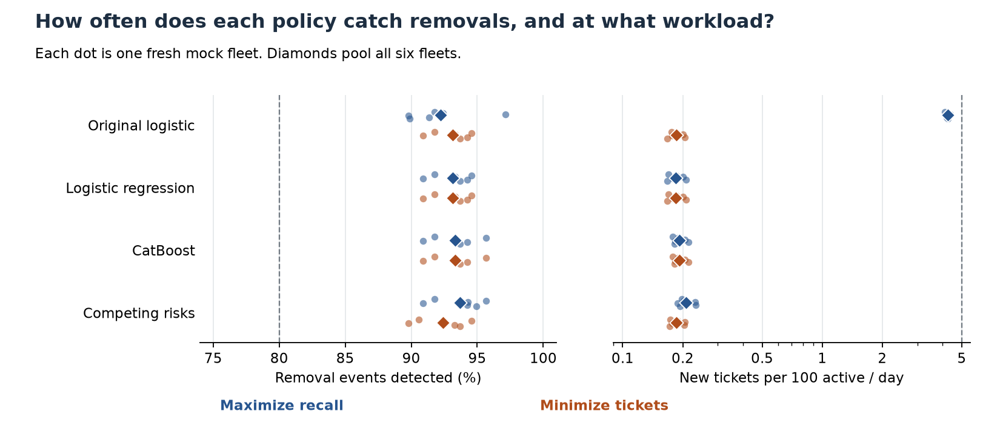

# Planning the maintenance review queue

Three models and two ticket policies were compared on 6 fresh mock fleets containing 553 unscheduled removals in total. The two operational questions were how many removals a planning team could anticipate and how many tickets it would have to investigate.

**Shadow-pilot candidate.** Validation selected Logistic regression at 0.95 as the lowest-workload eligible candidate, before the new fleets were scored. It detected 515/553 events (93.1%) across those fleets. Per-fleet recall ranged from 90.9% to 94.6%. It met both targets on 6/6 fleets, with 544 tickets and at least five cycles of notice for 487/553 events.

**If planners need five cycles to arrange parts or a maintenance slot**, the competing-risk model at 0.80 delivered that notice for 515/553 events, with 611 tickets. Compare this option in shadow against the workload-first candidate. Five cycles is an illustrative lead requirement pending confirmation by planners.

## Results on fresh fleets

| Model | Validation policy | Cutoff | Events detected | Recall | Fleets meeting both targets | New tickets / 100 per day | Ticket precision | Events warned ≥5 cycles ahead | Peak open / 100 |
|---|---|---:|---:|---:|---:|---:|---:|---:|---:|
| Logistic regression | Maximize recall | 0.95 | 515/553 | 93.1% | 6/6 | 0.18 | 95.8% | 88.1% | 2.50 |
| Logistic regression | Minimize tickets | 0.95 | 515/553 | 93.1% | 6/6 | 0.18 | 95.8% | 88.1% | 2.50 |
| CatBoost | Maximize recall | 0.95 | 516/553 | 93.3% | 6/6 | 0.19 | 92.2% | 90.4% | 2.50 |
| CatBoost | Minimize tickets | 0.95 | 516/553 | 93.3% | 6/6 | 0.19 | 92.2% | 90.4% | 2.50 |
| Competing risks | Maximize recall | 0.80 | 518/553 | 93.7% | 6/6 | 0.21 | 85.8% | 93.1% | 2.81 |
| Competing risks | Minimize tickets | 0.95 | 511/553 | 92.4% | 6/6 | 0.19 | 94.5% | 87.9% | 2.50 |
| Original logistic | Maximize recall | 0.06 | 510/553 | 92.2% | 6/6 | 4.25 | 4.1% | 85.2% | 53.75 |
| Original logistic | Minimize tickets | 0.95 | 515/553 | 93.1% | 6/6 | 0.19 | 95.6% | 88.6% | 2.50 |

Original logistic replays the previously published model at the two cutoffs determined by its original validation cohort. This reference isolates the alert-policy change on exactly the same six fleets. The other three candidates use the extended common training window. When both selection objectives choose the same cutoff, the two reported rows coincide.

Changing only the original model's ticket rule moved workload from 12,490 to 545 tickets while detected events moved from 510 to 515. Early low-score tickets can remain open when the signal becomes stronger. An example in the [original case analysis](REPORT.md#example-decisions) documents this mechanism.

Recall, precision and ticket rate pool their respective counts. The five-cycle column asks what fraction of all removal events had at least five cycles of planning notice. The final column counts all outstanding tickets. The assessment cap is enforced on newly opened tickets every day.

## Model choices

**Logistic regression** estimates how the measured signals combine additively on the log-odds scale. **CatBoost** uses the same features to learn nonlinear responses and interactions. Both directly predict the 30-cycle label and weight positive records fourfold. **The competing-risk model** uses CatBoost as a shared three-class estimator across six five-cycle intervals. At each landmark it estimates conditional chances of continued service, planned removal and unscheduled removal. Each interval's unscheduled risk is multiplied by the estimated probability of still being in service at its start. The six contributions sum to the 30-cycle cumulative incidence. A planned exit removes the installation from subsequent risk sets. All six forecasts use only signals available at the original scoring time. The hazard fit uses natural class frequencies and the same fully observed training landmarks as the direct models. Probability calibration on real fleet records would be needed for cost estimates in currency.

## How the comparison was locked

The first assessment's training period contained zero planned exits. For this study, the same 80 training aircraft were observed through November 14, 2024, by which time the ledger contained 38 planned exits. Training landmarks had to mature by that cutoff. All three candidates were refit on those same landmarks. Nine candidate cutoffs were replayed on 40 other validation aircraft between November 15, 2024 and April 14, 2025, with warm-up and follow-up guards. The original test aircraft were excluded. One policy maximizes event recall under the hard daily cap and breaks ties by fewer tickets. The other minimizes tickets among cutoffs reaching 80% event recall under the same cap, with higher recall breaking ties. A model with no qualifying cutoff has no minimum-ticket policy. Higher thresholds break remaining ties.

The stored thresholds were frozen before the six new fleets were scored. Each seed generates 40 aircraft for 365 days starting May 1, 2025. Aircraft and serial IDs are namespaced by seed. Each fleet is evaluated from November onward, with the same warm-up and outcome-maturity guards measured in flown cycles. The two policies see identical observations and events within each fleet. They differ in ticket timing, which changes when a 30-cycle open ticket suppresses another alert.

The experiment measures variation in the same simulator. Changes in fault mechanisms, aircraft utilization or work-order practice require real observations. Five cycles is a planning sensitivity check. The MRO team would set its minimum useful notice and record engineer minutes and avoided disruption in a shadow pilot.

[Frozen validation policies](results/locked_policies.csv) · [All validation operating points](results/study_validation.csv) · [Results for every fleet](results/fleet_policy_results.csv)

## When might the removal occur?

The competing-risk model also estimates cumulative unscheduled-removal incidence at intermediate horizons. These are the three cases chosen in the original assessment, scored using the observations available that day. Case labels refer to the original logistic policy. Values are model estimates on synthetic data. [All six horizons](results/horizon_examples.csv).

| Case from the original holdout | Serial | By 5 cycles | By 10 | By 20 | By 30 | Outcome |
|---|---|---:|---:|---:|---:|---|
| Detected removal | SN-001157 | 25.4% | 61.8% | 94.8% | 97.8% | Unscheduled removal in 7 cycles |
| False alert | SN-001263 | 7.6% | 25.4% | 64.3% | 73.2% | No unscheduled removal in 30 cycles |
| Missed removal | SN-001630 | 78.7% | 98.3% | 99.9% | 99.9% | Unscheduled removal in 3 cycles |
