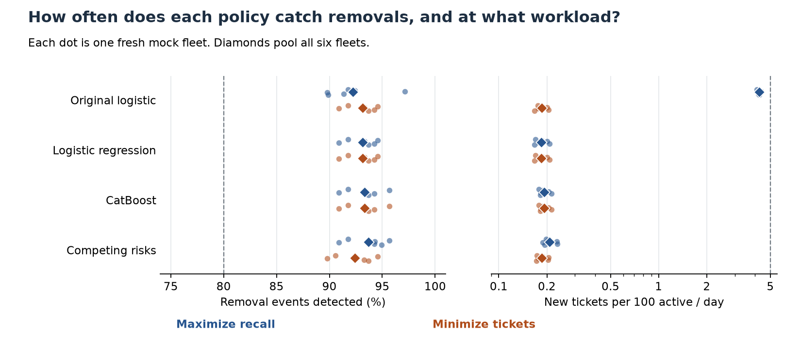

# Aircraft component removal risk

This proof of concept scores each installed component for an unscheduled removal within its next 30 flight cycles. All aircraft, serials, sensor measurements and removals are synthetic.

**Which components should planners inspect, and how much warning will they get?** The initial assessment compares logistic regression with CatBoost. The follow-up study adds a discrete-time competing-risk model that estimates unscheduled-removal risk at 5, 10, 15, 20, 25 and 30 cycles while accounting for planned removals.

On six new simulated fleets, the validation-selected workload policy detected **515 of 553** unscheduled removals with **544 tickets**. The competing-risk early-warning policy gave at least five cycles of notice for **515 events**, compared with **487** for the workload policy. The study reports every fleet, cutoff and ticket count. [Model selection and fleet study](FLEET_STUDY.md)

[Original assessment report](REPORT.md) · [Dataset and schema](data/README.md) · [Prediction examples](results/examples.csv) · [Risk by forecast horizon](results/horizon_examples.csv) · [Latest fleet scores](results/latest_fleet_scores.csv)

## Reproduce the assessment

Use 64-bit Python 3.13. From this directory in PowerShell, run the following commands.

~~~powershell
python -m venv .venv
.venv\Scripts\python -m pip install -r requirements.txt
.venv\Scripts\python simulate.py
.venv\Scripts\python -m unittest -v
.venv\Scripts\python assess.py
.venv\Scripts\python fleet_study.py
~~~

On macOS or Linux, use the Python executable in `.venv/bin`. The fixed-seed mock data is included, so the simulation step is optional. The assessment verifies the published labels against the removal ledger before fitting. It exports the validation threshold sweep, held-out scores, policy decisions and report. To score another compatible file of active-component histories using the fitted winner, run the command below after training.

~~~powershell
.venv\Scripts\python score.py data/observations.csv.gz results/latest_fleet_scores.csv
~~~

The scoring input needs enough preceding observations for each installation to build trailing features. It may omit the outcome label. Output covers every active component in the last fleet snapshot. The daily ticket rules are evaluated separately in the historical replay.

To score with the competing-risk model or the validation-selected shadow candidate, pass `--model results/competing_risks.joblib` or `--model results/shadow_policy.joblib` to the scoring command and choose a separate output file.
